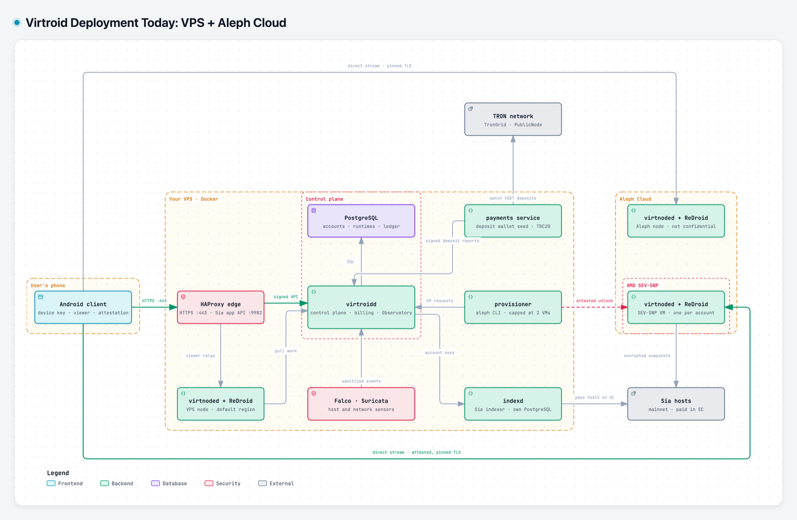

<!-- markdownlint-disable MD013 MD033 MD041 -->

<h1 align="center">Virtroid</h1>

  <strong>Private, remotely hosted Android environments.</strong> 
  Create, control, persist, reset, and destroy cloud Android runtimes from one Android client.

  
  
  
  

 

---

## What Virtroid Does

Virtroid runs Android separately from the user's physical phone. The phone is an
authenticated controller and encrypted viewer; applications, storage, network
identity, and lifecycle state remain inside a remotely hosted ReDroid runtime.
Users pay for what they use from a USDT balance.

  <a href="#what-virtroid-does">Overview</a> ·
  <a href="#capabilities">Capabilities</a> ·
  <a href="#architecture">Architecture</a> ·
  <a href="#security-boundary">Security</a> ·
  <a href="https://virtroid.network/demo/">Browser Emulated App Demo</a> ·

 

> [!IMPORTANT]
> Virtroid is currently a **trusted-operator release candidate**: one VPS, an
> ordinary runtime node on Aleph Cloud, and a pilot of per-account confidential
> (AMD SEV-SNP) VMs on Aleph Cloud. Outside that pilot it does not protect an
> active runtime from a compromised host or privileged infrastructure operator.

---

## Capabilities

| Area | Status | Included |
| :--- | :---: | :--- |
| Identity and recovery | ✅ Deployed | Invite-gated bootstrap, device signing, linked-phone management, identity password changes, account deletion, and replacement-phone recovery with live acceptance pending |
| Runtime lifecycle | ✅ Deployed | Create, start, stop, restore, persona restart, factory reset, idle cleanup, and permanent deletion |
| Remote viewer | ✅ Deployed | Encrypted live control, reconnect handling, runtime audio, demand-activated physical microphone input, and 30 fps runtimes (about 0.3 s tap-to-screen on the VPS) |
| Camera and media | ✅ Deployed | Explicit physical-camera photo and video capture followed by guest media import |
| Applications | ✅ Deployed | Each runtime's own F-Droid apps, chosen when it is created or later from its controls, from a paged and searchable catalog of pinned entries; the node installs them once, and F-Droid on the runtime can install more |
| Notifications | ✅ Deployed | Encrypted forwarding of package, app label, timestamp, and title only; no message body or preview |
| Client protection | ✅ Deployed | Android Keystore, encrypted local state, application lock, biometric unlock, and secure-window handling |
| Wallet and billing | ✅ Deployed | USDT (TRC20) deposits to a per-account address, balance and activity in the app, a free trial of one runtime and one hour of running time, then per-minute runtime and daily storage charges |
| Snapshot persistence | ✅ Deployed | Encrypted local snapshots, authenticated manifests, monotonic generations, rollback rejection, quotas, and cleanup tracking |
| Control plane | ✅ Deployed | Signed requests, scoped capabilities, replay protection, policy limits, readiness, lifecycle state, and audit data |
| Operator console | ✅ Deployed | The Observatory: an authenticated, read-only command centre with sanitized fleet, runtime VM, payments, Sia, security, hygiene, and release telemetry |
| Host monitoring | ✅ Deployed | Falco HIDS, Suricata NIDS, bounded sensor ingestion, and sanitized client security notices |
| Reproducible deployment | ✅ Deployed | Protected VPS-local builds, immutable release identity, schema checks, hardening checks, and health gates |
| Active-runtime file import | ✅ Backend path | Signed and bounded delivery is live-proved; the generic client upload action is intentionally absent |
| Multi-node scheduling | 🟡 Pilot | Region-based placement across the VPS, an Aleph Cloud node, and per-account confidential VMs |
| Direct node streaming | 🟡 Pilot | Phones stream straight from a remote node over key-pinned TLS (IPv6), falling back through the VPS edge when there is no direct route |
| Automatic node provisioning | 🟡 Pilot | The provisioner creates a dedicated Aleph Cloud VM when an account in a provisioned region starts a runtime, and deletes unused ones, within a spending cap |
| Confidential host isolation | 🟡 Pilot | Runtime VMs are AMD SEV-SNP guests with a measured, verified read-only root and an encrypted data disk unlocked only after attestation |
| Hardware attestation | 🟡 Pilot | The phone verifies the VM's SEV-SNP report against AMD's root before streaming, and accepts only images on a list of measurements signed with an offline key (app 0.3.7 and later) |
| Sia storage | 🟡 Pilot | The Sia indexer runs on the VPS on Sia mainnet with its storage contracts; a 64 MiB snapshot saves at about 5 MiB/s and restores at about 18 MiB/s, spread over 30 hosts so any 10 recover it |
| Deposit conversion | ⏳ Not built | Moving deposits to a treasury and converting them into Siacoin and Aleph credits; done by hand today |

---

## Architecture

The diagram shows the planned system. Parts of it run today; the rest is being built.
[What runs today](#what-runs-today) covers the current deployment.

 

<picture>
  <source media="(prefers-color-scheme: dark)" srcset="assets/architecture/virtroid-target-dark.png">
  
</picture>

### Starting a session

1. **Start.** The phone sends a request signed with its Android Keystore key to the edge, the only public entry point.
2. **Verify.** The edge passes it to `virtroidd`, which checks the signature, the account, and its credits.
3. **Provision.** The provisioner reuses the user's VM, takes a warm spare, or has Aleph create a new SEV-SNP VM. It releases the VM's disk key only after the AMD measurement matches the published image.
4. **Boot.** The VM boots that measured image. Each session starts a fresh ReDroid container.
5. **Attest, then stream.** The phone checks the VM's SNP attestation report: AMD's signature, the image measurement, and the VM's TLS key bound into the report. Only then does it stream straight from the VM over QUIC. Without a direct route, the stream goes through the edge, still end-to-end encrypted.
6. **Restore and save.** `/data` is restored from Sia before Android boots. On stop, changed chunks are encrypted inside the VM and saved back.

### The runtime VM image

The encrypted image is a full Linux VM disk, not an Android build. It holds a
minimal Debian with a kernel that has Android's binder driver, the boot loader,
Docker, `virtnoded`, the attestation agent, and the viewer encryption proxy.
Android runs as a ReDroid container inside it. The disk is encrypted and
SEV-SNP encrypts the VM's memory, so the host sees neither in the clear. AMD's
measurement of the boot chain is what the phone checks before trusting the VM. User data is not baked into the image;
it lives on Sia.

### Around the session

- **Placement.** Each account has a region, and a user's VM is never shared. South-East Asia and Australia are served from an SEV-SNP server in the region (for example Singapore); Europe and the US use Aleph's SNP nodes, paid per hour.
- **Lifecycle.** A connected runtime is hot. A disconnected one is kept warm for 15 minutes for instant reconnects, then saved to Sia and removed. The VM itself is destroyed after long inactivity, on image updates, or if compromise is suspected. The provisioner's Aleph account holds a capped credit balance.
- **The VPS.** The edge, control plane, payments, and storage are isolated from each other. Nodes and runtime agents come in through the edge like phones do. Falco, Suricata, and auditd ship logs off-host to an append-only bucket.
- **User data.** The durable copy is on Sia only, encrypted before it leaves the VM. `indexd` sees only opaque metadata and pays Sia hosts in SC.
- **Money.** Users deposit USDT (TRC20) to their own deposit address. Deposits become a USDT balance, spent per minute a runtime runs and per GB stored per day. New accounts get one runtime and an hour of running time free.

The diagram's source is [`assets/architecture/virtroid-target.archify.json`](assets/architecture/virtroid-target.archify.json).

### What runs today

| Component | Responsibility |
| :--- | :--- |
| Android client | Identity, onboarding, wallet, runtime controls, local security, viewer, attestation checks, media capture, and notification display |
| HAProxy | Public HTTPS termination, the API, viewer ingress for VPS runtimes and the fallback path, and the Sia indexer's application API |
| `virtroidd` | Accounts, devices, policy, billing, region-based placement, runtimes, capabilities, sessions, notification delivery, and the Observatory |
| `virtnoded` | ReDroid lifecycle, media paths, viewer relay, application provisioning, snapshots, and cleanup, on the VPS and on every remote node |
| Provisioner | Creates each confidential VM on Aleph Cloud, sends its secrets only after verifying its attestation, and deletes it when unused |
| Confidential runtime VM | One per account in a provisioned region: an AMD SEV-SNP guest booting the measured image from [`deploy/aleph/`](deploy/aleph/README.md) with `virtnoded` and ReDroid |
| Aleph node | The original remote node: an ordinary, non-confidential Aleph Cloud VM serving one assigned account |
| Payments service | Holds the deposit wallet's seed, finds confirmed USDT deposits on TRON, checks them on a second node, and reports them to `virtroidd` |
| Sia indexer (indexd) | Gives each account its own keys and pays Sia hosts for the encrypted snapshots that confidential VMs store |
| PostgreSQL | Authoritative control-plane, billing, and lifecycle state |
| ReDroid | Independently hosted Android runtime |
| Runtime agent | Allowlisted notification metadata collection inside the guest |

- **Control** always goes through the VPS: the phone's signed requests reach `virtroidd` through the edge, and nodes send heartbeats and fetch their work the same way.
- **Placement** follows the account's region. Accounts default to the VPS; an operator assigns an account to a region with `virtroid-admin set-account-region`. In a provisioned region, starting a runtime gets the account its own confidential VM, which takes a few minutes the first time; the VM is deleted after two unused hours.
- **Streams** from VPS runtimes pass through the edge. Streams from a remote node go straight from the phone to the node, which proves its identity with a TLS key pinned in the session; a confidential VM also has to pass the phone's attestation check first. When the phone has no direct route (for example no IPv6), the VPS node forwards the stream unchanged.
- On every path the viewer stream is encrypted between the phone and the viewer proxy inside the runtime, so the edge and a forwarding node only relay ciphertext.
- **Snapshots** are encrypted before they leave the runtime's node. On the VPS and the Aleph node they stay on that node's disk. Confidential VMs store them on Sia through the indexer, so a stopped runtime can restart on a new VM; until the indexer is ready they stay on the VM's own disk.
- **Payments.** Each account's deposit address derives from one wallet whose seed only the payments service holds ([`deploy/vps/payments.md`](deploy/vps/payments.md)). Each deposit is credited once.

Not built yet: QUIC streaming, automatic deposit conversion, and the custom AOSP image.

Diagram of today's deployment

 
<picture>
  <source media="(prefers-color-scheme: dark)" srcset="assets/architecture/virtroid-deployment-dark.png">
  
</picture>

Source: [`assets/architecture/virtroid-deployment.archify.json`](assets/architecture/virtroid-deployment.archify.json).

---

## Security Boundary

Outside the confidential pilot, Virtroid protects the client-to-service path and
stopped-runtime persistence, but the runtime host stays trusted. A sufficiently
privileged VPS administrator, compromised node agent, Docker controller, or
host-level tool can inspect or alter a live Android runtime. The same applies to
the original Aleph node, an ordinary VM whose host operator can see its runtimes.

Accounts in a provisioned region run in their own AMD SEV-SNP VM. The CPU
encrypts its memory; its firmware, kernel, initrd and read-only root are
measured; its data disk is encrypted; and the phone checks its attestation
before streaming. The Aleph host operator cannot read that runtime. Still
trusted there:

- whoever builds the image, though anyone can rebuild it and compare the measurement;
- the provisioner on the VPS, which holds each VM's data-disk key;
- the control plane, which decides where runtimes run.

Phones accept a VM only if its measurement is on a list signed with an
offline key; app releases before 0.3.7 refuse these VMs.

### Implemented controls

- P-256 device, node, capability, and callback signing
- Timestamp, nonce, body-integrity, and replay validation
- Runtime- and session-scoped capabilities with expiry
- TLS viewer transport with session-bound relay credentials
- Remote nodes reached only at operator-allowlisted IPs, over TLS pinned to each node's reported key, for both control-plane calls and phone streams
- SEV-SNP attestation of runtime VMs, checked by the provisioner before it releases a VM's secrets and by the phone before it streams
- Android Keystore-backed client secrets and encrypted local state
- AES-GCM snapshot encryption with authenticated manifests and monotonic generations, under an account key wrapped by the user's identity password
- Identity password changes accepted only with a signature from the account's recovery key
- Deposit addresses derived from a public key, with the wallet seed held only by the isolated payments service, which signs its reports
- Bounded resource quotas and explicit lifecycle cleanup obligations
- Loopback-bound services, deny-by-default firewalling, AppArmor, Auditd, Fail2ban, and unattended security updates
- Falco and Suricata event collection with sanitized, account-scoped client delivery
- Protected, offline VPS release builds with immutable image and deployment-tree verification

 

> [!CAUTION]
> Virtroid must not currently be described as trustless, operator-blind,
> anonymous by architecture, or fully end-to-end encrypted. Confidential
> computing covers only the SEV-SNP pilot, verified by app 0.3.7 and later.
> Elsewhere, transport encryption protects data in transit and snapshot
> encryption protects stopped-runtime files; neither makes an active guest
> confidential from its host.

---

## Repository map

| Path | Purpose |
| :--- | :--- |
| [`android-client/`](android-client/) | Android controller app, runtime agent, scrcpy integration, tests, and signing gates |
| [`operator-console/`](operator-console/) | The Observatory: the React operator console and its production bundle |
| [`backend/cmd/`](backend/cmd/) | Control plane, node agent, provisioner, payments service, administration, viewer encryption, and sensor entry points |
| [`backend/internal/`](backend/internal/) | Identity, policy, billing, persistence, lifecycle, Sia, TRON, security, and operator API logic |
| [`deploy/vps/`](deploy/vps/) | Reproducible deployment, hardening, HAProxy, Falco, Suricata, the Sia indexer and payments services, and release tooling |
| [`deploy/aleph/`](deploy/aleph/) | The confidential runtime VM image, its kernel, and the operator guide for provisioning |
| [`deploy/provisioner/`](deploy/provisioner/) | The provisioner image: `virtroid-provisioner` plus Aleph's `aleph` CLI |
| [`assets/`](assets/) | Architecture diagram images and their Archify source |
| [`third_party/`](third_party/) | Reviewable vendored source, provenance, and upstream notices | 

---

## Current status

The Android client, Go control plane, runtime node, ReDroid guests, PostgreSQL,
HAProxy edge, Observatory, and host sensors are deployed on the active VPS, with
the payments service and the Sia indexer beside them. Physical-device acceptance
has covered runtime lifecycle, encrypted viewing and reconnection, audio,
demand-activated microphone input, physical-camera photo import, file delivery,
idle cleanup, readiness, and security-event delivery.

Confidential runtime VMs are running as a pilot on Aleph Cloud: accounts in the
SEV-SNP region get their own VM on demand, and the app streams from it after
checking its attestation against the signed list of approved images. The original Aleph node still serves one
assigned account; phones stream from it directly over IPv6, with a measured
tap-to-screen of about 0.42 s from South-East Asia to the node in Finland,
against about 0.3 s on the VPS.

USDT deposits and charging are live, and new accounts start on a one-runtime,
one-hour trial. The Sia indexer holds storage contracts with over 30 hosts, and
saving and restoring snapshots through it is proven on Sia mainnet.

This is working release-candidate evidence—not a claim of complete production
hardening or hostile multi-tenant isolation.

### Next

1. Sia storage: prove on a real phone that a stopped runtime restarts from Sia on a new VM ([`deploy/vps/indexd.md`](deploy/vps/indexd.md)).
2. Move deposits to a treasury and convert them into Siacoin and Aleph credits automatically.
3. A custom AOSP build for the runtime, and QUIC for the stream.

> [!NOTE]
> **Disclaimer:**
> Virtroid is under active development. Security properties, interfaces, schemas, and deployment procedures may change.
> Do not use it for high-risk or production-sensitive workloads without independently reviewing the source,
> deployed configuration, threat model, recovery design, runtime-host trust, and storage limitations.

---

  

